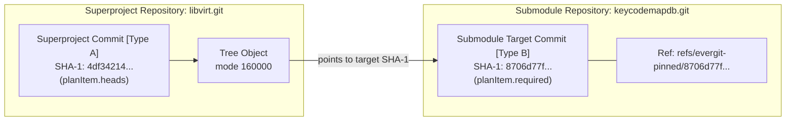
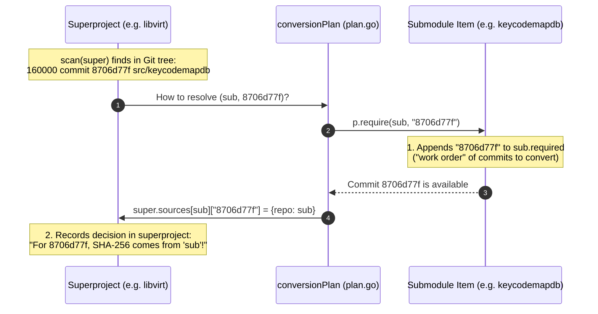
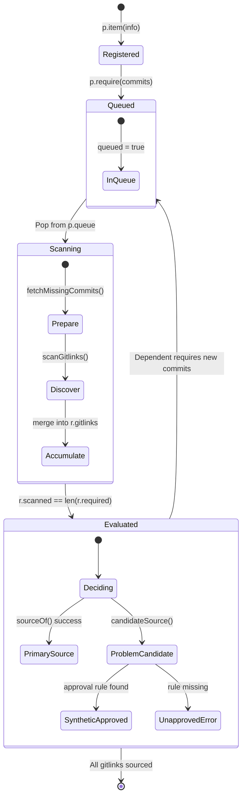
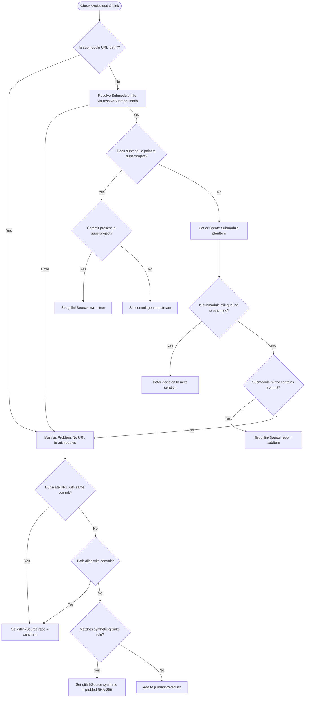

# Low-Level Design (LLD): Evergit Conversion Planner (`plan.go`)

This technical document specifies the Low-Level Design for `internal/converter/plan.go`. All text complies with **ASD-STE100 (Simplified Technical English)** rules.

---

## 1. Scope and Architectural Role

The `plan.go` module plans the full repository conversion before any Git object changes on disk.

### Core Invariants
* **Zero Object Mutation:** The planner creates zero Git objects. It only computes the conversion graph.
* **Deterministic Sourcing:** The translation source of a commit depends only on Git history. It never depends on previous conversion state.
* **Fail-Fast Approvals:** Missing administrator approvals stop the process before object rewriting starts.
* **Bounded Repository Graph:** Submodule count cannot exceed `-max-submodule-repos`.

---

## 2. Static Call Tree

```text
planConversion(info, commits)
  │
  ├── config.LoadSyntheticGitlinks()
  ├── p.item(info) -> initializes root planItem
  ├── p.require(top, commits...) -> sets queued=true, appends to p.queue
  │
  ├── p.walk()
  │     │
  │     ├── [Phase A: Drain Queue]
  │     │     └── p.scan(r)
  │     │           ├── p.prepare(r)
  │     │           │     ├── missingCommits()
  │     │           │     └── p.fetchMissingCommits(missing)
  │     │           └── p.discover(r, heads)
  │     │                 └── discoverGitlinks()
  │     │                       ├── scanGitlinks() -> git log --raw
  │     │                       └── gitmodulesURLs() -> git cat-file
  │     │
  │     └── [Phase B: Decide Sources]
  │           └── p.decide(r)
  │                 ├── p.undecided(r)
  │                 ├── p.sourceOf(r, submodule, commit)
  │                 │     ├── resolveSubmoduleInfo()
  │                 │     ├── p.ownSource() -> submodule points to superproject
  │                 │     └── p.require(sub, commit) -> queues child submodule
  │                 └── p.decideProblems(r, problems)
  │                       ├── p.candidateSource(r, submodule, commit)
  │                       │     ├── candidate 1: duplicate URL with same commit
  │                       │     └── candidate 2: submoduleAliases()
  │                       └── p.synthetic(r, submodule, commit, reason)
  │                             ├── matches p.approvals rule?
  │                             ├── approved -> setSource(synthetic)
  │                             └── unapproved -> p.unapproved[r.id]++
  │
  └── p.approvalError() -> halts if len(p.unapproved) > 0
```

---

## 3. Commit Taxonomy: Superproject vs. Submodule Target Commits

Evergit strictly distinguishes between two types of Git commits during conversion:

### Type A: Superproject Commit (History Commit)
* **Definition:** A commit object that belongs to the superproject's own repository history.
* **Role:** Represents an entry in the superproject revision history.
* **Git Tree:** Its Git tree object contains directory entries with mode `160000` (gitlink).
* **Storage Field:** Stored in `planItem.heads` (when `r` is the superproject).

### Type B: Submodule Target Commit (Submodule Commit)
* **Definition:** A commit object that belongs to the submodule's repository history.
* **Role:** The target commit referenced by a superproject gitlink entry.
* **Mirror Pin:** Kept under `refs/evergit-pinned/<submodule-sha1>` in the submodule mirror.
* **Storage Field:** Stored in `planItem.required`, `planItem.gitlinks`, and `planItem.sources`.



### 3.1 Detailed Clarification of the Bridge Concepts

#### Concept 1: `Stored in: planItem.required (of submodule)`
* **Owner:** The `planItem` of the **submodule** (e.g. `keycodemapdb.git`), not the superproject.
* **Mechanism:** When the superproject scans its history and finds a gitlink pointing to commit `8706d77f`, the planner executes:
  ```go
  p.require(subItem, "8706d77f")
  ```
* **Role (Work Order):** This slice represents the "work order" for the submodule. Submodules are only partially converted. The `subItem.required` list instructs the submodule exactly which commits it must fetch from upstream and pin under `refs/evergit-pinned/8706d77f`.

#### Concept 2: `super.sources[sub][8706d77f] = {repo: sub}`
* **Owner:** The `planItem` of the **superproject** (e.g. `libvirt.git`), in its `sources` map.
* **Components:**
  * `super`: The superproject item.
  * `[sub]`: The submodule URL (e.g. `https://gitlab.com/...`).
  * `[8706d77f]`: The submodule commit hash recorded in the tree.
  * `{repo: sub}`: Pointer to the submodule item producing the SHA-256 hash.
* **Role (Translation Routing):** When the superproject rewrites its Git tree in `rewriteObjects`, it reads `super.sources[sub][8706d77f]`, finds `sub`, extracts its converted SHA-256 from `loose-object-idx`, and writes the new SHA-256 into the tree entry.



---

## 4. Data Structures & Key Semantics Reference

### Direct Answers to Commit Semantics
* **`gitlinks[submoduleURL][commit]`:** The `commit` key is **strictly the Submodule Target Commit** (the SHA-1 hash recorded in tree mode `160000`). It is **never** the superproject commit.
* **`sources[submoduleURL][commit]`:** The `commit` key is **strictly the Submodule Target Commit**. It designates which submodule commit receives the SHA-256 translation decision.
* **`planItem.recording[submoduleURL][commit]`:** The outer key is `submoduleURL`. The inner key is `commit` (the **Submodule Target Commit**). Unlike `r.gitlinks` (which covers only the commits currently being converted), `r.recording` covers the **entire revision history** of the repository (`heads = nil, exclude = nil`). It allows the planner to answer: *"Across our entire history, did any other submodule URL record this same submodule commit?"*

### 4.1 Commit Field Classification

The table below classifies every struct field containing commit hashes:

| Struct & Field | Go Type | Commit Classification | Role & Description (ASD-STE100) |
| :--- | :--- | :--- | :--- |
| `planItem.heads` | `[]string` | **Superproject Commit** (when super) / **Submodule Commit** (when sub) | Commits of *this repository* whose history was scanned. |
| `planItem.required` | `[]string` | **Submodule Target Commit** | Commits of *this repository* required by superprojects. |
| `planItem.gitlinks` | `map[string]map[string]bool` | **Submodule Target Commit** (inner key) | `gitlinks[subURL][commit]` holds submodule commits discovered in history. |
| `planItem.sources` | `map[string]map[string]gitlinkSource` | **Submodule Target Commit** (inner key) | `sources[subURL][commit]` assigns the SHA-256 source to the submodule commit. |
| `planItem.recording` | `map[string]map[string]bool` | **Submodule Target Commit** (inner key) | Full history submodule commits used for candidate repository lookup. |
| `planItem.present` | `map[string]bool` | **Submodule Target Commit** (key) | True if submodule commit was in mirror before network fetch. |
| `planItem.gone` | `map[string]bool` | **Submodule Target Commit** (key) | True if upstream mirror confirmed submodule commit is absent. |
| `pathGitlink.target` | `string` | **Submodule Target Commit** | Target SHA-1 read directly from Git tree mode 160000. |
| `recordedGitlink.commit` | `string` | **Submodule Target Commit** | Submodule commit recorded during history walk. |
| `gitlinkSource.own` | `bool` | **Superproject Commit** | True if submodule commit is actually a commit of the superproject itself. |

### 4.2 Complete Map Key Semantics Matrix

The table below defines the precise semantic of every map key across the planner:

| Map Name | Key Level | Key Semantic (What it represents) | Example Value |
| :--- | :--- | :--- | :--- |
| `conversionPlan.items` | Single Key | Canonical repository ID (normalized domain and path). | `"github.com/libvirt/libvirt"` |
| `conversionPlan.unapproved` | Single Key | Canonical repository ID of the superproject needing approvals. | `"github.com/libvirt/libvirt"` |
| `conversionPlan.completed` | Single Key | Pointer to `planItem` completed during execution. | `*planItem` |
| `conversionPlan.converting` | Single Key | Canonical repository ID actively converting (cycle detector). | `"github.com/keycodemap/keycodemapdb"` |
| `planItem.gitlinks` | Outer Key | Submodule URL from `.gitmodules` or `"path:<path>"`. | `"https://gitlab.com/keycodemap/keycodemapdb.git"` |
| `planItem.gitlinks` | Inner Key | **Submodule Target Commit** (SHA-1 in submodule history). | `"8706d77f..."` |
| `planItem.sources` | Outer Key | Submodule URL from `.gitmodules` or `"path:<path>"`. | `"https://gitlab.com/keycodemap/keycodemapdb.git"` |
| `planItem.sources` | Inner Key | **Submodule Target Commit** (SHA-1 in submodule history). | `"8706d77f..."` |
| `planItem.recording` | Outer Key | Submodule URL recorded anywhere in entire repository history. | `"git://git.sv.gnu.org/gnulib.git"` |
| `planItem.recording` | Inner Key | **Submodule Target Commit** recorded anywhere in history. | `"c1a2b3d4..."` |
| `planItem.aliases` | Single Key | Submodule directory path inside the superproject tree. | `".gnulib"` or `"src/keycodemapdb"` |
| `planItem.present` | Single Key | **Submodule Target Commit** checked in local mirror. | `"8706d77f..."` |
| `planItem.gone` | Single Key | **Submodule Target Commit** absent from upstream remote. | `"deadbeef..."` |
| `planItem.previouslyDecided` | Single Key | SHA-1 object ID translated during a previous conversion. | `sha1ID` (20-byte binary hash) |

---

## 5. Component Interaction Sequence

```mermaid
sequenceDiagram
    autonumber
    participant Manager as Manager (converter.go)
    participant Planner as conversionPlan (plan.go)
    participant Queue as p.queue ([]*planItem)
    participant Mirror as Git Mirror (Storage)
    participant Submodule as Submodule Item

    Manager->>Planner: planConversion(info, commits)
    Planner->>Queue: Push top repository (p.top)
    
    loop Until Queue is Empty and No Progress
        rect rgb(25, 35, 55)
            Note over Planner,Queue: Phase A: Drain Queue (p.scan)
            Planner->>Queue: Pop item r
            Planner->>Mirror: prepare: fetch missing commits
            Planner->>Mirror: discover: scan tree gitlinks and .gitmodules
            Planner->>Planner: Merge targets into r.gitlinks
        end
        
        rect rgb(35, 45, 30)
            Note over Planner,Submodule: Phase B: Decide Sources (p.decide)
            Planner->>Planner: Find undecided (submodule, commit)
            alt Primary Submodule Valid
                Planner->>Submodule: p.require(commit) -> Push to Queue
                Planner->>Planner: Assign gitlinkSource{repo: Submodule}
            else Commit Missing / URL Failed
                Planner->>Planner: Check candidate duplicates & aliases
                alt Candidate Found
                    Planner->>Planner: Assign candidate repository
                else No Candidates
                    Planner->>Planner: Check synthetic approval
                end
            end
        end
    end

    Planner-->>Manager: Return plan or ErrSubmoduleApprovalRequired
```



---

## 6. State Machine: `planItem` Lifecycle



---

## 7. Algorithmic Procedures

### 7.1 `walk()` Engine Procedure
```text
Procedure walk():
1. Loop continuously.
2. While len(p.queue) > 0:
   a. Pop item r = p.queue[0].
   b. Set r.queued = false.
   c. Execute scan(r).
   d. If scan(r) returns an error, stop procedure with error.
3. Set progressed = false.
4. For each repository ID in sorted alphabetical order:
   a. Get item r = p.items[id].
   b. Execute decide(r).
   c. If decide(r) assigned new sources, set progressed = true.
5. If len(p.queue) == 0 AND progressed == false:
   a. Exit loop.
6. Return nil.
```

### 7.2 `scan(r)` Commit and Tree Discovery
```text
Procedure scan(r):
1. Execute heads, ok = prepare(r).
2. If ok == false, return nil.
3. Call targets = discover(r, heads).
4. Update scanned boundary:
   a. If heads == nil: Set r.heads = []string{} (indicates full scan complete).
   b. If heads != nil: Append heads to r.heads.
5. For each submodule and commit set in targets:
   a. If r.gitlinks[submodule] is nil, initialize set.
   b. Add commits to r.gitlinks[submodule].
6. Return nil.
```

---

## 8. Decision Tree / Waterfall



---

## 9. Error Handling & Invariants Matrix

| Condition | Trigger | Handled By | Outcome |
| :--- | :--- | :--- | :--- |
| `len(p.items) > maxRepos` | Submodule graph exceeds limit | `p.item()` | Returns `ErrTooManySubmodules`. Halts planning. |
| Submodule URL missing in `.gitmodules` | Path without URL entry | `p.sourceOf()` | Assigns `path:<path>`. Routes to candidate lookup. |
| Submodule upstream missing commit | Commit removed upstream | `p.fetchMissingCommits()` | Marks `r.gone[c] = true`. Routes to candidate lookup. |
| HTTP redirect to unapproved host | Submodule redirects outside whitelist | `probeUpstream()` | Sets `r.unavailable = err`. Routes to candidate lookup. |
| Missing synthetic approval rule | No matching rule in config file | `p.synthetic()` | Records `p.unapproved[r.id]`. Halts with `ErrSubmoduleApprovalRequired`. |

---

## 10. Real-World Case Study: `libvirt` & `keycodemapdb`

This section traces the real-world conversion of **libvirt** (superproject on GitHub) and its operative submodule **keycodemapdb** (on GitLab).

### Repository and Commit Profiles
* **Superproject:** `github.com/libvirt/libvirt.git`
* **Submodule:** `gitlab.com/keycodemap/keycodemapdb.git` (directory: `src/keycodemapdb`)
* **Original SHA-1 Gitlink:** `8706d77f75845c43d969f6487e38a39a77953258`
* **Rewritten SHA-256 Gitlink:** `3f8a91b2c45e8901fa72...`

```mermaid
sequenceDiagram
    autonumber
    actor Client as Git Client
    participant Server as Server / Resolver
    participant Planner as Planner (plan.go)
    participant Libvirt as planItem (libvirt)
    participant Keycode as planItem (keycodemapdb)
    participant Executor as Executor (rewrite.go)
    participant Upstream as Remote Upstreams

    Client->>Server: 1. git clone libvirt.git
    Server->>Upstream: 2. syncMirror(libvirt) from github.com

    rect rgb(25, 35, 55)
        Note over Server,Keycode: Phase 1: Planning libvirt (plan.go)
        Server->>Planner: 3. planConversion(libvirt)
        Planner->>Libvirt: scan(libvirt): finds gitlink 160000 commit 8706d77f
        Planner->>Libvirt: gitmodulesURLs: maps to gitlab.com/.../keycodemapdb.git
        Planner->>Keycode: 4. p.require(keycodemapdb, "8706d77f")
        Note over Keycode: keycodemapdb.required = ["8706d77f"] (queued)
        Planner->>Upstream: 5. p.fetch calls syncMirror(): git clone --bare from gitlab.com
        Planner->>Upstream: 6. fetchMissingCommits(8706d77f) from gitlab.com
        Planner->>Libvirt: 7. libvirt.sources[keycodemapdb]["8706d77f"] = {repo: keycodemapdb}
    end

    rect rgb(35, 45, 30)
        Note over Server,Executor: Phase 2: Execution & Rewrite (rewrite.go)
        Server->>Executor: 8. plan.convert(libvirt)
        Executor->>Keycode: Step 2A: Convert keycodemapdb first
        Note over Keycode: 8706d77f -> 3f8a91b2 (loose-object-idx)
        Executor->>Libvirt: Step 2B: Rewrite libvirt tree
        Note over Libvirt: 160000 commit 3f8a91b2 src/keycodemapdb
        Executor->>Server: Symlinks published in storage/repos/...
    end

    Server-->>Client: 9. git upload-pack libvirt (SHA-256 stream)
    Client->>Server: 10. git submodule update --init (fetches 3f8a91b2 from keycodemapdb)
```



### Step-by-Step Execution Summary
1. **Superproject Scan:** Planner scans `libvirt` trees and finds `src/keycodemapdb` pointing to commit `8706d77f`. It reads `.gitmodules` and maps it to `https://gitlab.com/keycodemap/keycodemapdb.git`.
2. **Submodule Work Order & Mirror Clone:** Planner creates child item `keycodemapdb` and calls `p.require(keycodemapdb, "8706d77f")`. It adds `"8706d77f"` to `keycodemapdb.required`. When `scan(keycodemapdb)` runs, `p.fetch` checks `if !r.synced`, calling `p.m.syncMirror()` which executes `cloneMirror` (`git clone --bare`) to create the bare mirror on disk. Next, `fetchMissingCommits` verifies and downloads `8706d77f` from GitLab.
3. **Translation Decision:** Planner assigns `libvirt.sources[keycodemapdb]["8706d77f"] = {repo: keycodemapdb}`.
4. **Execution Order:** Executor converts `keycodemapdb` first, producing SHA-256 `3f8a91b2` in `loose-object-idx`. Executor then converts `libvirt`, reads `libvirt.sources`, and rewrites the tree line to `160000 commit 3f8a91b2 src/keycodemapdb`.
5. **Submodule Update:** When the client later runs `git submodule update --init`, Evergit serves `keycodemapdb` where `refs/evergit-pinned/8706d77f` reaches commit `3f8a91b2`.

